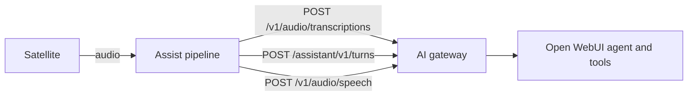

# Open WebUI Agent

**Home Assistant talks only to your home AI gateway, through this one integration.**

It gives Home Assistant three things, all served by the gateway:

- a **conversation agent** (the gateway runs the Open WebUI agent, its tools, memory and chats),
- **speech-to-text** (the gateway's voice pipeline, with speaker identification and transcript repair),
- **text-to-speech** (the gateway's speech profile, with translation when needed).

In the other direction it gives the gateway what its household reviews need: a read-only view of the entities you exposed to Assist (`GET /api/oikos`) and the household events it pushes (arrivals and departures, doors left open, devices that go offline).

**Nothing else is needed in Home Assistant.** No OpenAI STT/TTS integrations, no extra components or add-ons, no API keys of Open WebUI. Everything stays on your network; there is no cloud service.

**Version 3.2.0.** This is an independent community project, not an official Home Assistant or Open WebUI integration. The old direct Open WebUI mode still works but is [deprecated](#direct-open-webui-mode-deprecated).

## Setup in three steps

1. **Install.** In HACS open the three-dot menu → **Custom repositories**, add `https://github.com/bpepino/ha-openwebui-agent` with category **Integration**, download **Open WebUI Agent** and restart Home Assistant.
2. **Enter the URL.** Open **Settings → Devices & services → Add integration → Open WebUI Agent → AI gateway** and enter the gateway's URL, for example `http://192.168.1.20:8000`. Leave the token empty unless your gateway requires tokens. Choose the language you speak. The test step shows the gateway's version and whether it runs in open mode; submit to save.
3. **Select it in Assist.** Open **Settings → Voice assistants**, pick your assistant and set **Conversation agent**, **Speech-to-text** and **Text-to-speech** to **AI gateway**.

That is all. The three entities (`conversation.ai_gateway`, `stt.ai_gateway_speech_to_text`, `tts.ai_gateway_text_to_speech`) share one **AI gateway** device, which shows the gateway's version and links to its dashboard.

Manual installation instead of HACS: copy `custom_components/openwebui_agent` into your configuration's `custom_components` folder and restart. Keep the folder name; it is the integration's domain.

## Requirements

- Home Assistant **2026.6.0 or newer**.
- The home AI gateway reachable from Home Assistant, normally on your LAN (default port 8000). The gateway needs Open WebUI and its voice engines; Home Assistant needs only the gateway.

## Open mode and tokens

The gateway runs in **open mode** by default: requests from your network need no token and run as the household owner. Leave the token empty.

When the gateway's **Require tokens** setting is on, create an API client of kind `ha` in the gateway dashboard (**API clients → Create client**) and paste its token. The token is shown only once. Home Assistant sends `Authorization: Bearer <token>` only when a token is configured.

The test step reads the mode from the gateway's `GET /health` (`open_mode`) and says whether a token is needed; a gateway that does not report it is asked with a token-free request instead. If the gateway later starts requiring tokens, revokes yours, or answers that the token lacks the `assistant:turns` scope (403), Home Assistant asks for a new token (reauthentication) and keeps the entry and its Assist selection.

Household events use their own token: an API client of kind `events`. Enter it under **Configure → Household events** only when the gateway requires tokens; in open mode the events are sent without one.

To change the URL, token or language later, use **Reconfigure** on the integration entry. The test step runs again before anything is saved.

## Options

**Configure** on the integration entry has five settings, plus a collapsed **Household events** section:

| Setting | Default | Meaning |
| --- | --- | --- |
| Turn timeout | 120 seconds | How long Home Assistant waits for an answer. Sent as `timeout_s`; the gateway's profile can only shorten it. If it passes after the gateway accepted the request, Home Assistant asks for the answer for up to this long again. |
| Voice | empty | Text-to-speech voice. Empty uses the gateway's speech profile voice. |
| Audio format | MP3 | The container the gateway returns when the whole answer is spoken at once: MP3, WAV or Opus (Ogg). Home Assistant converts it for your satellites when they need another format. |
| Speak while the answer streams | on | Speak each sentence as soon as the gateway sends it, so long answers start sooner (MP3, converted for your satellite). Off: the whole answer is spoken at once in the audio format above. Turn it off if your satellite plays streamed speech with gaps. |
| Fall back to Home Assistant when the gateway is unreachable | off | Let Home Assistant's own Assist agent answer basic commands while the gateway cannot be reached. See [Degraded mode](#degraded-mode). |
| Household events → Send events to the gateway | on | Push the [household events](#household-events) below. |
| Household events → Persons | empty | Whose arrivals and departures are sent, also when not exposed to Assist. Empty: every person exposed to Assist. |
| Household events → Door open too long after | 10 minutes | A door, window or garage door sensor open this long sends `door_open_long`. |
| Household events → Device unavailable after | 2 minutes | An exposed entity unavailable this long sends `device_unavailable`. |
| Household events → Every state change | off | Also send `state_changed` for every exposed entity. Only for a small exposed set: the gateway rate limits events. |
| Household events → Events token | empty | An `events` API client token, needed only when the gateway requires tokens. |

Model, tools, memory, thinking, chat history and who is speaking are decided by the gateway, not here.

## What happens on a voice request



### Speech-to-text

The recording is uploaded as a WAV file (OpenAI multipart: `file`, `model`, `language`) in the Assist pipeline's language (its base code, for example `en` for `en-US`), or the language you configured when the pipeline has none. The gateway identifies the speaker. Home Assistant uses the transcript's `plain_text`, otherwise `text`. It never uses the repaired household-language text (`fixed_greek`): the gateway matches the turn that follows against `text`/`plain_text` to know who spoke and which language to answer in.

### Conversation

Home Assistant sends the text, its conversation ID, the language, the satellite's device ID, the device's area name and the turn timeout, and asks for a streamed answer:

```json
{
  "conversation_id": "01JHAEXAMPLE0000000000000",
  "text": "Turn on the office light",
  "language": "en",
  "device_id": "9a8b7c6d5e4f3a2b1c0d9e8f7a6b5c4d",
  "area": "Office",
  "timeout_s": 120,
  "response": {"speech": false, "stream": true}
}
```

Fields without a value are left out. When Assist names only the satellite entity, its device and area come from the entity, device and area registries. Prompts from Home Assistant's side (`extra_system_prompt`, for example from `assist_satellite.start_conversation`) are not forwarded: the gateway sets the context of its own questions.

The gateway answers with server-sent events: `status`, one `delta` per finished sentence (its direct path; the Open WebUI path sends none), then `final` with the whole answer, or `error`. Each `delta` goes into Home Assistant's chat log as it arrives, so the Assist dialog shows the answer growing and the voice pipeline can start speaking it. A gateway that answers plain JSON is read as before.

- **Long turns.** When the turn timeout passes after the gateway accepted the request, the gateway answers `504` with `still_running: true` and a `turn_id`, and keeps waiting. Home Assistant then asks `GET /assistant/v1/turns/{turn_id}` every 2 seconds for up to the turn timeout. A finished turn is spoken as usual; a failed one speaks its error. If the turn is unknown or expired (404), the follow-up fails, or the time runs out, you hear "I'm still working on that": the request may still finish and act, so don't repeat it. The request itself is never sent twice.
- **Follow-ups.** Home Assistant's conversation ID maps to the gateway conversation the reply names. When the gateway starts a new chat (`new_chat`), the mapping is replaced. Mappings are kept in memory for the 256 most recent conversations.
- **Listening again.** The gateway decides whether the satellite listens again without the wake word: `continue_conversation` in its answer (its follow-up switch is on, the answer asks a question, no confirmation is pending, and the answer is not degraded). Home Assistant never turns it on by itself; a gateway that does not send the field falls back to `expects_reply`. A follow-up is an ordinary new turn with the same conversation, device and area; the gateway identifies the speaker again.
- **Speech and display.** Assist speaks the gateway's TTS-ready text: the streamed sentences, or `speech_text` for a short or unstreamed answer. The chat shows the streamed sentences, or `display_text`.
- **Questions and approvals.** For an action that needs your approval, or a question of its own, the gateway asks through the satellite itself (`assist_satellite.ask_question` or `start_conversation`, over its own connection to Home Assistant). The satellite needs the start-conversation feature. Your reply to a started conversation comes back to this agent as an ordinary turn with the satellite's device. Nothing needs to be set up here.

### Text-to-speech

Home Assistant sends `{model, input, voice, response_format}` to `/v1/audio/speech` with your configured voice and plays the returned audio. The gateway translates from English into its speech profile's language when needed.

With **Speak while the answer streams** on, the text is cut into sentences with the gateway's own rule (after `.` `!` `?` `;` `…` or a paragraph break; never inside `3.5` or `7:30`; the first piece may end at a comma after 40 characters; at most 220 characters) and each sentence is requested as MP3 as soon as it is complete. The sentences play as one stream. Home Assistant's voice pipeline hands an answer over this way once more than 60 characters have streamed; shorter answers are spoken in one go. With the option off, every answer is one request in the configured format.

## Degraded mode

When the assistant cannot answer normally, Home Assistant's own Assist agent can answer basic commands instead. Such an answer starts with "Assistant offline, basic commands only." and never keeps the satellite listening. Nothing is retried.

- **At the gateway.** When the gateway's owner turns on degraded mode in its household settings (off by default) and the gateway's assistant upstream is offline, the gateway answers satellites and Home Assistant text itself, through Home Assistant's agent, and marks the answer `degraded: true`. Home Assistant speaks it as usual.
- **Here, while the gateway is unreachable.** Only with **Fall back to Home Assistant when the gateway is unreachable** turned on (off by default). It applies when the gateway cannot be reached at all: a connection or DNS failure, or a 5xx from a proxy in front of it. It never applies to a `4xx` or to a `504 still_running`, because that request may still act. Home Assistant's agent then gets the same text, conversation, language and satellite. It executes intents itself, outside the gateway's action policy, which is why you have to turn it on. With the option off you hear "I can't reach the assistant gateway right now."

Both are shown the same way: the conversation entity's `degraded` attribute is `true` after a degraded answer (and `false` after a normal one), each degraded answer fires an `openwebui_agent_degraded` event with `source` (`gateway` or `home_assistant`), `device_id` and `satellite_id`, and diagnostics count them. For example, to be told about it:

```yaml
triggers:
  - trigger: event
    event_type: openwebui_agent_degraded
actions:
  - action: persistent_notification.create
    data:
      message: "The assistant answered in degraded mode ({{ trigger.event.data.source }})."
```

## Household events

The gateway's household reviews read the house through this integration and receive its events. Both use only the entities you exposed to Assist (**Settings → Voice assistants → Expose**).

**Exposed entities.** `GET /api/oikos` answers the exposed entities: `{"assistant", "count", "entities": [...], "push": {...}}`. Each entity has `entity_id`, `name`, `aliases`, `domain`, `state`, `available` and, as asked, `area_name` (the entity's area, else its device's), compact `capabilities`, `actions` hints and executable `services`. The gateway calls `?area=1&caps=1&assistant=conversation`; `slim=1` gives only names and areas, `attrs=1` full attributes. It is read-only and needs a Home Assistant token, which you set in the gateway.

**Events.** Home Assistant posts each event to the gateway's `POST /household/v1/events`:

| Type | When | Priority |
| --- | --- | --- |
| `person_arrived_home` | a tracked person changes to `home` | normal |
| `person_left_home` | a tracked person changes from `home` to anything else | normal |
| `door_open_long` | an exposed door, window, garage door or opening sensor stays open for the configured time | high |
| `device_unavailable` | an exposed entity stays `unavailable` for the configured time | normal |
| `device_available` | it comes back (only after a `device_unavailable`) | low |
| `state_changed` | only with **Every state change**: an exposed entity's state changed | low |

Each event has a deterministic `event_id` made from its type, entity and the time of the state change, so a retried event is a duplicate at the gateway, never a second one. Newer gateways also derive the same events from their own connection to Home Assistant, with the same IDs, and drop the duplicates; keep this push on, it still covers the gateway's connection being down or lacking an admin token. Attribute-only updates, zone-to-zone moves and changes through `unavailable`/`unknown` are not sent; pictures, URLs, tokens, locations and network addresses never leave Home Assistant. Delivery: 5 s timeout, up to 3 attempts (2 s and 8 s apart) on timeouts, connection errors, 408, 429 and 5xx; a rate-limited answer is retried once after 60 s. The queue is in memory (200 events). Problems are logged at most once a minute.

## Ask before acting (`openwebui_agent.ask_action`)

From 3.3. An automation can propose an action without running it: the gateway checks it like any other plan (the entities must be exposed, the service must be one the gateway runs, levels, budgets, undo), asks on a voice satellite and runs it only on a yes. Home Assistant never runs it. The gateway store's question recipes (bedtime sweep, window open while heating or AC runs, water heater on too long) use it. The gateway needs **proactive questions** switched on; otherwise it refuses.

```yaml
action: openwebui_agent.ask_action
data:
  question: bedtime_sweep            # a short id for the gateway's log
  satellite: assist_satellite.bedroom
  steps:
    - service: light.turn_off
      entity_id: [light.kitchen, light.hall]
```

| Field | |
| --- | --- |
| `question` | required: lowercase letters, digits and `_` |
| `steps` | required, 1 to 12: `service` (`light.turn_off`, or `turn_off` for each entity's own domain), `entity_id` (one or a list, at most 40 in all), optional `data` with plain values |
| `satellite` | optional: the `assist_satellite` that asks; without it, one in `area`, else one where people are |
| `area` | optional: an area id |
| `context` | optional: up to 8 plain values kept in the gateway's log, never spoken |

Nothing that still looks like a template is sent. The call goes to the gateway's `POST /household/v1/ask_action` with the gateway token (the one the assistant turns use; none in open mode). The gateway answers `asked`, `skipped` (quiet hours, nobody home, the satellite busy, nothing to turn off, the same question already waiting) or `refused` (for example an entity not exposed, a level-4 device, proactive questions off). A refusal fails the action, so the automation's trace shows the reason; the answer is the action's response. A no, or no answer on the satellite, drops it.

## Errors you may hear

| You hear | Meaning |
| --- | --- |
| I can't reach the assistant gateway right now. | The gateway is down, or the URL or port is wrong. |
| I'm still working on that … | The turn timeout passed after the gateway accepted the request. It may still finish. |
| Assistant offline, basic commands only. … | [Degraded mode](#degraded-mode): Home Assistant's own agent answered. |
| The assistant gateway needs a token for Home Assistant. / … rejected this Home Assistant token. | The gateway requires tokens, or revoked yours. Home Assistant asks for a new one. |
| Cannot connect to Open WebUI … / Open WebUI rejected the API key … | The gateway reached the turn but Open WebUI failed, or the household member's Open WebUI key is missing. Fix it in the gateway. |
| The assistant gateway is not set up for this device yet. | The API client's profile or user is incomplete in the gateway. |

Every gateway error code maps to a translated message. A code newer than this version is classified by its HTTP status.

## Diagnostics and logs

**Download diagnostics** on the integration entry shows whether speech streams, the path of the last turn (`direct` or `openwebui`), a live gateway check (status, version, open mode and whether a token is needed, unavailable subsystems, the gateway's degraded mode), whether a token is configured, the degraded answers (the last one's source and a count) and whether the fallback is on, the language and options, the household event counts (sent, failed, rate limited, filtered, queued) and whether an events token is set, the number of mapped conversations, the last turn's timings and its identity confidence. It never contains the URL or a token.

For debug logs:

```yaml
logger:
  logs:
    custom_components.openwebui_agent: debug
```

Logs never contain prompts, transcripts, answers or the token.

## Troubleshooting

| Symptom | Checks |
| --- | --- |
| "This URL did not answer like the AI gateway" | Enter the gateway's URL and port (default 8000), not the Open WebUI URL. |
| "The gateway requires a token" | The gateway's **Require tokens** setting is on. Create an API client of kind `ha` and paste its token, or turn the setting off. |
| Setup keeps retrying | The gateway is unreachable from Home Assistant. Check the host, port and firewall. |
| The satellite says nothing or plays silence | Check the gateway's speech engines in its dashboard. The gateway answers silence for short command acknowledgements on purpose. |
| Spoken answers have gaps or start only at the end | Turn **Speak while the answer streams** off in **Configure**: the whole answer is then spoken at once. |
| Speech is recognized but the wrong person is greeted | The gateway matches the transcript to the speaker it identified. Two satellites hearing the same sentence at once can swap speakers. |
| "I'm still working on that" often | Raise the turn timeout in **Configure**, and check the gateway profile's completion timeout. |
| The gateway sees no entities | Expose them to Assist. The gateway needs a Home Assistant token to read `/api/oikos`. |
| Household events do not arrive | Check the push counts in diagnostics. A `401` means the gateway requires tokens: enter an `events` token under **Configure → Household events**. |

## Security

Keep the gateway on your LAN. In open mode anyone on your network can use it as the household owner; turn on **Require tokens** in the gateway if that is not wanted, and give Home Assistant an `ha` token and an `events` token. `/api/oikos` is read-only and requires a Home Assistant token. Use HTTPS when the gateway is reached across an untrusted network. See [SECURITY.md](SECURITY.md).

## Updating from 2.x

- **2.1.0 gateway entries** keep working. After the update they also get the speech-to-text and text-to-speech entities; select them in your Assist pipeline and remove any separate OpenAI speech integrations that pointed at the gateway. Settings that 2.1.0 showed are no longer shown: SSL verification and the request timeout keep their saved values; Continue listening and Strip Markdown no longer apply, because the gateway decides when to listen again and sends plain text.
- **Direct Open WebUI entries** keep working. Home Assistant shows a repair notice for each one. To move: add the integration again and choose **AI gateway**, select the new entities in your Assist pipeline, then delete the direct entry.

## Direct Open WebUI mode (deprecated)

Before 3.0.0 this integration talked to Open WebUI directly, running the saved-chat native agent protocol itself. That mode still exists behind **Add integration → Open WebUI Agent → Open WebUI directly (deprecated)** and will be **removed in a future release**. It provides only a conversation agent. Its documentation is kept in [docs/direct-mode.md](docs/direct-mode.md).

## Uninstalling

Remove the integration in Devices & services, then remove it from HACS (or delete its folder) and restart. Revoke the gateway API client if you created one.

## Development and contributing

See [development](docs/development.md), [acceptance tests](docs/testing.md), [changelog](CHANGELOG.md) and [contributing](CONTRIBUTING.md). Never post tokens or API keys in issues.

## Upstream and license

Open WebUI Agent for Home Assistant was originally forked from [TheRealPSV/ha-openwebui-conversation](https://github.com/TheRealPSV/ha-openwebui-conversation), which was based on [ej52/hass-ollama-conversation](https://github.com/ej52/hass-ollama-conversation/). The original [AGPL-3.0 license](LICENSE) is preserved unchanged.
