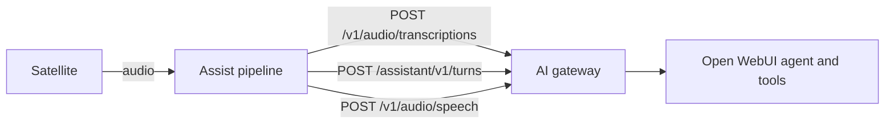

# Open WebUI Agent

**Home Assistant talks only to your home AI gateway, through this one integration.**

It gives Home Assistant three things, all served by the gateway:

- a **conversation agent** (the gateway runs the Open WebUI agent, its tools, memory and chats),
- **speech-to-text** (the gateway's voice pipeline, with speaker identification and transcript repair),
- **text-to-speech** (the gateway's speech profile, with translation when needed).

**Nothing else is needed in Home Assistant.** No OpenAI STT/TTS integrations, no extra add-ons, no API keys of Open WebUI. Everything stays on your network; there is no cloud service.

**Version 3.0.0.** This is an independent community project, not an official Home Assistant or Open WebUI integration. The old direct Open WebUI mode still works in 3.0.0 but is [deprecated](#direct-open-webui-mode-deprecated).

## Setup in three steps

1. **Install.** In HACS open the three-dot menu → **Custom repositories**, add `https://github.com/bpepino/ha-openwebui-agent` with category **Integration**, download **Open WebUI Agent** and restart Home Assistant.
2. **Enter the URL.** Open **Settings → Devices & services → Add integration → Open WebUI Agent → AI gateway** and enter the gateway's URL, for example `http://192.168.1.20:8000`. Leave the token empty unless your gateway requires tokens. Choose the language you speak. The test step shows the gateway's version and whether it runs in open mode; submit to save.
3. **Select it in Assist.** Open **Settings → Voice assistants**, pick your assistant and set **Conversation agent**, **Speech-to-text** and **Text-to-speech** to **AI gateway**.

That is all. The three entities (`conversation.ai_gateway`, `stt.ai_gateway_speech_to_text`, `tts.ai_gateway_text_to_speech`) share one **AI gateway** device, which shows the gateway's version and links to its dashboard.

Manual installation instead of HACS: copy `custom_components/openwebui_agent` into your configuration's `custom_components` folder and restart. Keep the folder name; it is the integration's domain.

## Requirements

- Home Assistant **2026.6.0 or newer**.
- The home AI gateway reachable from Home Assistant, normally on your LAN (default port 8000). The gateway needs Open WebUI and its voice engines; Home Assistant needs only the gateway.

## Open mode and tokens

The gateway runs in **open mode** by default: requests from your network need no token and run as the household owner. Leave the token empty.

When the gateway's **Require tokens** setting is on, create an API client of kind `ha` in the gateway dashboard (**API clients → Create client**) and paste its token. The token is shown only once. Home Assistant sends `Authorization: Bearer <token>` only when a token is configured.

The test step tells you which mode the gateway is in. If the gateway later starts requiring tokens, or revokes yours, Home Assistant asks for a new token (reauthentication) and keeps the entry and its Assist selection.

To change the URL, token or language later, use **Reconfigure** on the integration entry. The test step runs again before anything is saved.

## Options

**Configure** on the integration entry has three settings:

| Setting | Default | Meaning |
| --- | --- | --- |
| Turn timeout | 120 seconds | How long Home Assistant waits for an answer. Sent as `timeout_s`; the gateway's profile can only shorten it. |
| Voice | empty | Text-to-speech voice. Empty uses the gateway's speech profile voice. |
| Audio format | MP3 | The container the gateway returns: MP3, WAV or Opus (Ogg). Home Assistant converts it for your satellites when they need another format. |

Model, tools, memory, thinking, chat history and who is speaking are decided by the gateway, not here.

## What happens on a voice request



### Speech-to-text

The recording is uploaded as a WAV file (OpenAI multipart: `file`, `model`, `language`) in the language you configured. The gateway identifies the speaker and repairs the transcript. Home Assistant uses the **repaired transcript** when the gateway returns one (`fixed_greek`, the historical name of that field), otherwise `text`.

### Conversation

Home Assistant sends the text, its conversation ID, the language, the satellite's device ID, the device's area name, any `extra_system_prompt` (for example from `assist_satellite.start_conversation`) and the turn timeout:

```json
{
  "conversation_id": "01JHAEXAMPLE0000000000000",
  "text": "Turn on the office light",
  "language": "en",
  "device_id": "9a8b7c6d5e4f3a2b1c0d9e8f7a6b5c4d",
  "area": "Office",
  "extra_instructions": "Keep it short.",
  "timeout_s": 120,
  "response": {"speech": false, "stream": false}
}
```

Fields without a value are left out. When Assist names only the satellite entity, its device and area come from the entity, device and area registries.

- **Long turns.** If the gateway answers `still_running` with a `turn_id`, Home Assistant polls `GET /assistant/v1/turns/{turn_id}` every second until the answer is ready or the turn timeout passes. Then you hear "I'm still working on that": the request may still finish and act, so don't repeat it. Nothing is retried automatically.
- **Follow-ups.** Home Assistant's conversation ID maps to the gateway conversation the reply names. When the gateway starts a new chat (`new_chat`), the mapping is replaced. Mappings are kept in memory for the 256 most recent conversations.
- **Listening again.** When the gateway answers `expects_reply: true` (the answer asks a question), the satellite keeps listening. Say **"let's talk"** to keep listening after statements for the current session, and **"end conversation"**, "stop talking" or "that's all" to stop.
- **Speech and display.** Assist speaks the gateway's TTS-ready `speech_text` and shows `display_text` in the chat.

### Text-to-speech

Home Assistant sends `{model, input, voice, response_format}` to `/v1/audio/speech` with your configured voice and format and plays the returned audio. The gateway translates from English into its speech profile's language when needed.

## Errors you may hear

| You hear | Meaning |
| --- | --- |
| I can't reach the assistant gateway right now. | The gateway is down, or the URL or port is wrong. |
| I'm still working on that … | The turn timeout passed after the gateway accepted the request. It may still finish. |
| The assistant gateway needs a token for Home Assistant. / … rejected this Home Assistant token. | The gateway requires tokens, or revoked yours. Home Assistant asks for a new one. |
| Cannot connect to Open WebUI … / Open WebUI rejected the API key … | The gateway reached the turn but Open WebUI failed, or the household member's Open WebUI key is missing. Fix it in the gateway. |
| The assistant gateway is not set up for this device yet. | The API client's profile or user is incomplete in the gateway. |

Every gateway error code maps to a translated message. A code newer than this version is classified by its HTTP status.

## Diagnostics and logs

**Download diagnostics** on the integration entry shows a live gateway check (status, version, open mode, unavailable subsystems), whether a token is configured, the language and options, the number of mapped conversations, the last turn's timings and its identity confidence. It never contains the URL or the token.

For debug logs:

```yaml
logger:
  logs:
    custom_components.openwebui_agent: debug
```

Logs never contain prompts, transcripts, answers or the token.

## Troubleshooting

| Symptom | Checks |
| --- | --- |
| "This URL did not answer like the AI gateway" | Enter the gateway's URL and port (default 8000), not the Open WebUI URL. |
| "The gateway requires a token" | The gateway's **Require tokens** setting is on. Create an API client of kind `ha` and paste its token, or turn the setting off. |
| Setup keeps retrying | The gateway is unreachable from Home Assistant. Check the host, port and firewall. |
| The satellite says nothing or plays silence | Check the gateway's speech engines in its dashboard. The gateway answers silence for short command acknowledgements on purpose. |
| Speech is recognized but the wrong person is greeted | The gateway matches the transcript to the speaker it identified. Two satellites hearing the same sentence at once can swap speakers. |
| "I'm still working on that" often | Raise the turn timeout in **Configure**, and check the gateway profile's completion timeout. |

## Security

Keep the gateway on your LAN. In open mode anyone on your network can use it as the household owner; turn on **Require tokens** in the gateway if that is not wanted, and give Home Assistant an `ha` token. Use HTTPS when the gateway is reached across an untrusted network. See [SECURITY.md](SECURITY.md).

## Updating from 2.x

- **2.1.0 gateway entries** keep working. After the update they also get the speech-to-text and text-to-speech entities; select them in your Assist pipeline and remove any separate OpenAI speech integrations that pointed at the gateway. Settings that 2.1.0 showed (SSL verification, request timeout, Continue listening, Strip Markdown) keep their saved values but are no longer shown.
- **Direct Open WebUI entries** keep working in 3.0.0. Home Assistant shows a repair notice for each one. To move: add the integration again and choose **AI gateway**, select the new entities in your Assist pipeline, then delete the direct entry.

## Direct Open WebUI mode (deprecated)

Before 3.0.0 this integration talked to Open WebUI directly, running the saved-chat native agent protocol itself. That mode still exists for one release behind **Add integration → Open WebUI Agent → Open WebUI directly (deprecated)** and will be **removed in 3.1**. It provides only a conversation agent. Its documentation is kept in [docs/direct-mode.md](docs/direct-mode.md).

## Uninstalling

Remove the integration in Devices & services, then remove it from HACS (or delete its folder) and restart. Revoke the gateway API client if you created one.

## Development and contributing

See [development](docs/development.md), [acceptance tests](docs/testing.md), [changelog](CHANGELOG.md) and [contributing](CONTRIBUTING.md). Never post tokens or API keys in issues.

## Upstream and license

Open WebUI Agent for Home Assistant was originally forked from [TheRealPSV/ha-openwebui-conversation](https://github.com/TheRealPSV/ha-openwebui-conversation), which was based on [ej52/hass-ollama-conversation](https://github.com/ej52/hass-ollama-conversation/). The original [AGPL-3.0 license](LICENSE) is preserved unchanged.
