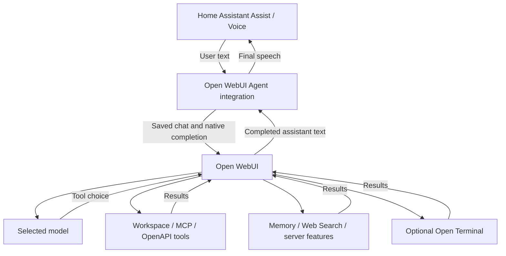

# Open WebUI Agent

**Home Assistant is the frontend. Open WebUI is the agent.**

A HACS custom conversation integration that sends Assist text to a real Open WebUI chat and waits for Open WebUI to finish its native server-side agent loop. Open WebUI chooses tools, executes them, processes their results, and produces the final response for Assist/TTS.

**Version 2.1.0.** User testing of 2.0.0 on Open WebUI 0.11.4 confirms working custom tools, memory and conversation history after the message-link fix. See the [acceptance tests](docs/testing.md) for checking your model and tool configuration. 2.1.0 adds an optional [gateway mode](#gateway-mode) that talks to a home AI gateway instead of Open WebUI; direct mode is unchanged and stays the default. This is an independent community project, not an official Home Assistant or Open WebUI integration.

## Why this exists

A plain completion request can return an unexecuted tool call. This integration uses Open WebUI's documented saved-chat native agent flow: create a linked message tree, submit a streaming completion with chat/message/session IDs, poll tasks, and retrieve the finished assistant message. It never interprets model output as a Home Assistant service call.



## Features

- Dynamically discovered base and Workspace/clone models, shown by friendly name.
- Real Open WebUI chats, stable sessions and linked multi-turn messages.
- Server-side Workspace, MCP and OpenAPI tool discovery and selection.
- Model tool defaults or a custom tool selection, without an OpenAI `tools` field.
- Separate Memory, Web Search, Code Interpreter and Image Generation flags.
- Optional discovered terminal or the selected model's default terminal.
- Async completion polling, separate request/completion timeouts, translated errors and sanitized diagnostics.
- Final-text Markdown stripping for voice; original chat content remains in Open WebUI.

These are implemented API paths, not a claim that every server feature has been tested end to end.

## Requirements

- Home Assistant **2026.6.0 or newer**. The old development configuration already pinned this version; the fork now makes that minimum explicit and uses its supported conversation lifecycle.
- An Open WebUI instance reachable from Home Assistant, an enabled API key, and permission to use the required endpoints. In [gateway mode](#gateway-mode) Home Assistant needs only the gateway and an API client token; the gateway needs Open WebUI.
- A model/provider that supports **Native function calling**, with streaming enabled. Clear a model's `Stream Chat Response = false` override.
- Current Open WebUI APIs described in [Server-Side Tool Calling](https://docs.openwebui.com/reference/server-side-tool-calling/). The source inspected identifies itself as **0.11.4**; see the [exact revision and compatibility assessment](docs/api-research.md). No numeric minimum or live-tested Open WebUI range has been established. A matching version number alone is not proof of compatibility.

## Configure Open WebUI first

1. Enable API keys and create a key for the user whose permissions the agent should have.
2. Select or create a Workspace model. Configure its provider, system prompt, Native function calling and permitted built-in capabilities in Open WebUI.
3. Attach any Workspace tools, MCP or OpenAPI servers to that model, or plan to select them explicitly in Home Assistant.
4. Verify the exact prompt and tool setup works in Open WebUI's browser as the same user.
5. For OAuth-protected MCP, complete authorization in that user's browser first.

Do not paste credentials into issue reports. If endpoint access is restricted, allow the endpoints in [API research](docs/api-research.md).

## Install with HACS

The fork URL was verified from this repository's Git remote:
[**bpepino/ha-openwebui-agent**](https://github.com/bpepino/ha-openwebui-agent).

1. In HACS, open the three-dot menu → **Custom repositories**.
2. Add `https://github.com/bpepino/ha-openwebui-agent`, category **Integration**.
3. Find **Open WebUI Agent**, download, and restart Home Assistant.
4. Open **Settings → Devices & services → Add integration → Open WebUI Agent**.

Version 2.0.0 and later install into `/config/custom_components/openwebui_agent`. The original integration uses `openwebui_conversation`, so the two can be installed separately. If you installed an earlier beta of this fork, follow [Updating and migration](#updating-and-migration) first.

These steps require the maintainer to push this implementation first. This work does not publish it or submit it to the default HACS catalog. HACS is configured to install the integration directory from repository source, without requiring a release ZIP.

## Manual installation

Copy `custom_components/openwebui_agent` into your Home Assistant configuration's `custom_components` directory and restart. Add **Open WebUI Agent** through Devices & services. Keep the `openwebui_agent` directory name; it matches this integration's domain.

## Home Assistant setup and options

1. **Connection:** instance name, Open WebUI URL, API key, SSL verification and request timeout. Setup validates the key by listing models.
2. **Model and features:** choose a discovered model, feature flags, Markdown stripping and timeouts.
3. **Tools:** choose model defaults or custom selection. The multi-select applies only to custom mode.
4. **Terminal:** none, model default or a specific discovered server.
5. Select the conversation entity in your Assist pipeline under **Settings → Voice assistants**. To test that Open WebUI performs home control, disable **Prefer handling commands locally** for that pipeline.

Open the integration's **Configure** action to refresh models, tools and terminals and edit options. If a resource temporarily disappears, its saved ID remains selectable and the form warns you. A missing model or explicitly selected tool fails clearly at runtime; it is never silently replaced with a different model/tool. An expired API key triggers Home Assistant's reauthentication flow.

Conversations reuse discovery metadata for up to 60 seconds. Saving Configure or reloading the integration applies server-side model/tool changes immediately. Open WebUI authorizes every completion; the metadata cache does not grant access or cache execution results.

| Setting | New-install default | Meaning |
| --- | --- | --- |
| Memory | On | Request Open WebUI memory tools, subject to permissions/capabilities |
| Web Search | On | Let the native agent decide whether to search |
| Code Interpreter | Off | Experimental; use a server engine such as Jupyter |
| Image Generation | Off | Open WebUI may create images; Assist receives text only |
| Tool mode | Model defaults | Read `info.meta.toolIds` and send exact accessible IDs |
| Thinking | Model default | Disabled requests `reasoning_effort: none`, supported by NInfer and compatible providers |
| Continue listening | Questions or "let's talk" | Continue on questions; voice command enables hands-free conversation for the current session |
| Keep chat history | Off | Delete integration-created chats after 15 minutes idle; preserve active-session follow-ups |
| Terminal | None | Explicitly opt into model-default or selected terminal access |
| Request timeout | 30 seconds | Maximum time for one HTTP request |
| Completion timeout | 120 seconds | Saved-chat creation/update, submission and completion wait |
| Poll interval | 2 seconds | Delay between active-task checks |
| Strip Markdown | On | Clean only the final spoken text |

Model/resource discovery happens before the completion deadline and is bounded by individual request timeouts.

## Gateway mode

Gateway mode sends Assist turns to a home AI gateway's assistant API (`/assistant/v1`) instead of to Open WebUI. The gateway runs the same saved-chat Open WebUI agent protocol described above, but centrally: one place decides the model and tools for every client (Home Assistant, a watch, ...) and who is speaking. Direct Open WebUI mode is unchanged and remains the default; existing entries are not touched.

### Set up

1. In the gateway dashboard open **Gateway → API clients → Create client** with kind `ha` and the household's default speaker as default user. Copy the token now; it is shown only once.
2. In Home Assistant add **Open WebUI Agent** and choose **Connection: AI gateway**.
   - **Open WebUI or gateway URL:** the gateway, for example `http://192.168.1.20:8000` (the voice proxy's host and port), not the Open WebUI URL.
   - **API key or gateway token:** the token from step 1.

   Setup calls `GET /assistant/v1/health` with the token. A rejected token, a wrong URL and an unreachable gateway are reported separately. If the gateway is up but cannot reach Open WebUI, setup still succeeds and the next step shows the status.
3. Choose **Answer timeout**, **Continue listening** and **Strip Markdown**, then select the new conversation entity in your Assist pipeline.

**Configure** shows only those settings plus SSL verification and the request timeout. A revoked token starts Home Assistant's reauthentication, which asks for a new token and keeps the entry in gateway mode.

### What the gateway decides

- **Model, tools, features and thinking:** the API client's assistant profile (model, tool selection, Memory, Web Search, thinking, background tasks). The Open WebUI options of direct mode are hidden.
- **Who is speaking:** each turn runs as a household member with that member's own Open WebUI key, so memory and tool permissions follow the person. Home Assistant cannot assert a speaker: the gateway uses the token's default user, or the speaker its own voice pipeline identified for the same transcript.
- **Conversations and chat history:** Home Assistant's conversation ID maps to a gateway conversation. The gateway decides when a new Open WebUI chat starts and deletes idle chats according to the profile. This integration's 15-minute cleanup and in-memory mappings are not used in gateway mode.
- **Context and answer shaping:** the gateway writes a `[gateway speaker=… device=… area=… lang=…]` line into the stored user message, and returns a display text and a speech text without Markdown, links or URLs. Its `expects_reply` hint (the answer asks a question) also keeps a satellite listening.

### What Home Assistant sends

The text exactly as recognized, HA's conversation ID, the language, the device ID (or the satellite entity ID), the device's area name, HA's `extra_system_prompt` (for example from `assist_satellite.start_conversation`) and the answer timeout:

```json
{
  "conversation_id": "01JHAEXAMPLE0000000000000",
  "text": "Turn on the office light",
  "language": "en",
  "device_id": "9a8b7c6d5e4f3a2b1c0d9e8f7a6b5c4d",
  "area": "Office",
  "extra_instructions": "Keep it short.",
  "timeout_s": 120,
  "response": {"speech": false, "stream": false}
}
```

Fields without a value are left out. The Home Assistant user ID is not sent yet: the gateway's request model has no field for it.

Home Assistant still owns the voice controls ("let's talk", "end conversation", **Continue listening**), Markdown stripping for the Assist chat, and translated error messages. Speech always uses the gateway's speech text.

### Timeouts and errors

**Answer timeout** (default 120 seconds) is sent as `timeout_s`; the gateway's profile can only shorten it. Home Assistant waits that long plus the request timeout for the reply. If the deadline passes after the gateway accepted the turn, you hear "I'm still working on that": the request may still finish and act, so don't repeat it. Nothing is retried automatically.

| You hear | Meaning |
| --- | --- |
| I can't reach the assistant gateway right now. | The gateway is down or the URL/port is wrong. |
| The assistant gateway rejected this Home Assistant token. | The token was revoked; reauthenticate. |
| Cannot connect to Open WebUI … / Open WebUI rejected the API key … | The gateway reached the turn but Open WebUI failed, or the household member's Open WebUI key is missing or invalid. Fix it in the gateway. |
| The assistant gateway is not set up for this device yet. | The API client's profile or user is incomplete in the gateway. |

Diagnostics in gateway mode contain the backend, the gateway's health (status, Open WebUI reachability and version, voice pipeline and retention flags), the settings above, the last turn's timings in milliseconds and its identity confidence. They never contain the URL or the token.

### Rollback

Keep, or add again, a direct **Open WebUI** entry with a different instance name. Both entries can exist at the same time; switching back is choosing the direct entry's conversation entity in the Assist pipeline. Downgrading the integration to 2.0.0 leaves gateway entries unable to load, so remove them before downgrading.

## Models, tools and terminals

Models come from `/api/models`, including Workspace clones and base models. Model/provider settings remain on Open WebUI. The integration requests native function calling and streaming; a detected model setting forcing legacy mode or disabling streaming is rejected.

The inspected server returns accessible Workspace, MCP and server-side OpenAPI resources together from `/api/v1/tools/`. IDs such as `server:mcp:...` are preserved exactly. Browser-local `direct_server:` connections are not supported: configure a server-side connection in Open WebUI instead.

**Use model defaults** reads the same `info.meta.toolIds` field used by Open WebUI's browser and explicitly sends accessible IDs. If only some defaults are unavailable, it skips those IDs with a log warning and keeps the available tools, matching browser selection. If all selected defaults are unavailable, it reports their IDs. A selected tool that explicitly needs OAuth produces a separate authorization error; complete that authorization in the browser as the API-key user. User-browser saved selections are not imported.

Custom mode sends the selected IDs. An empty selection means no external tools; built-in feature flags and backend-managed model knowledge remain independent. There is no model-specific function name in the integration.

**Use model default terminal** reads `info.meta.terminalId` and explicitly sends `terminal_id`. Terminal discovery excludes `contexts.chat: false`; chat-scoped terminals receive the real saved chat ID. The model's terminal capability must permit access.

## Built-in features

### Web Search

Configure a search engine and user/model permissions in Open WebUI, then enable Web Search here. Ask a natural question needing current information. There are no required trigger phrases and no Home Assistant search implementation.

### Memory

This is **Open WebUI Memory**, scoped by the API-key user. Enabling the flag requests access; it does not guarantee the model will save or recall every fact. Use the [memory acceptance test](docs/testing.md) and inspect Open WebUI's memory UI.

### Code, images and other capabilities

Code Interpreter's browser Pyodide engine requires a real browser connection and will not work through this HTTP client. Use Jupyter/server execution and test your setup. A generated session UUID enables documented server-side built-ins; it is not a connected WebSocket client.

Open WebUI remains responsible for knowledge and other built-ins it offers under its permissions/model settings. This integration does not implement separate Notes, Calendar, Automations, Tasks or sub-agent APIs, and these capabilities have not been live-tested here. It does not upload files, attach knowledge collections, import browser-selected skills/filters, render images or interactive artifacts, or answer browser confirmation dialogs. Model-attached knowledge remains subject to Open WebUI's backend behavior. Structured output and citations remain in the saved chat; source JSON is never spoken. A response containing only non-text output returns an error directing you to that chat.

## Control Home Assistant through Open WebUI

Configure a Home Assistant MCP/OpenAPI/Workspace tool **inside Open WebUI**, with suitable permissions:

`Assist → Open WebUI Agent → Open WebUI → Home Assistant MCP/tool → Home Assistant`

This integration does not expose Home Assistant entities as LLM tools, register a Home Assistant LLM API, or execute function calls. Only Open WebUI runs the agent loop. Test a device action in Open WebUI first, then follow the same-user/model test in [manual acceptance](docs/testing.md).

## Multi-turn conversations and chat visibility

Each Home Assistant conversation ID maps to its own saved chat and session. Follow-ups append linked user/assistant nodes, reuse that chat, and send the active branch with structured assistant output where present. Concurrent turns in one HA conversation are serialized; different conversations stay isolated.

Completion requests include the current user node and parent reference so Open WebUI preserves that branch when it saves its assistant placeholder. If a completed response contains raw unexecuted tool syntax, the error is reported and the previous successful branch is retained for the next user request. The failed response is excluded from that next branch; no action is automatically retried.

Chats are titled **Home Assistant**. Title, tag and follow-up generation are disabled to avoid extra model calls. By default, chats created under auto-cleanup are deleted after 15 minutes without a request, checked once per minute. An active local request or running Open WebUI task delays deletion. The API user needs permission to delete chats; connection/permission failures defer cleanup and log a warning. Enable **Keep chat history in Open WebUI** to retain chats and cancel pending cleanup.

Conversation context stays in Open WebUI, scoped to the current HA conversation. HA's satellite session handling reuses its conversation ID for follow-ups; the supported HA version expires idle sessions after about five minutes. The integration does not join separate sessions or different satellites into one history. It forwards HA's question/follow-up signal so supported satellites can listen again. There is no duplicate long-term HA memory, rolling prompt rewrite or automatic summarization.

Mappings are in memory, limited to 128 idle references per entry. Reload, restart, model changes, eviction or uncertain failure starts a fresh chat on the next turn. Only cleanup IDs and expiry times persist in HA so deletion resumes after restart; prompts and messages are not stored in that cleanup queue. Already-saved Open WebUI memories are separate from chat transcripts. Older untracked chats, including those made by beta.1, are untouched and can be removed manually.

A manually deleted chat is recovered once by creating a new one. Avoid editing an active Assist chat in the browser: browser edits do not select a new Assist branch or extend its cleanup deadline. This mode uses real saved chats during execution; true `temporary:` chats would require a different socket transport.

## Voice / Assist

Only the final assistant prose is returned. Structured reasoning and tool events are excluded, with the last assistant message used after tool rounds. Strip Markdown affects TTS only. Agent requests can take longer than a voice pipeline's own limit; increasing this integration's timeout does not change the pipeline's timeout.

On supported satellites, a reply ending in a question uses HA's built-in follow-up detection to listen again. Say **"let's talk"** (also "lets talk", "let us talk", or "start conversation mode") to continue after statements too, for the current session. Say **"end conversation"**, "stop talking", or "that's all" to stop. These optional voice commands currently use English phrases. **Continue listening → Always continue** requests another turn after every successful reply, with the same stop commands. Errors end automatic listening. The satellite still controls silence timeouts and wake-word behavior. The commands are forwarded unchanged to Open WebUI; no additional system prompt or message rewriting is introduced.

**Thinking → Disabled** requests actual reasoning disablement, rather than just hiding reasoning in speech. It passes `reasoning_effort: none` through Open WebUI; [NInfer documents this setting](https://github.com/Neroued/ninfer/blob/master/docs/serving.md). Other providers may not support it. Remove conflicting explicit `enable_thinking: true` settings from the Workspace model if applicable. Model default leaves reasoning settings to Open WebUI/provider defaults. Changing thinking mode can require a fresh prompt prefill; subsequent requests keep the same setting.

## Debugging and diagnostics

Enable integration logging with:

```yaml
logger:
  default: warning
  logs:
    custom_components.openwebui_agent: debug
```

Logs include versions, shortened chat IDs, model IDs, feature flags, tool counts, missing resource IDs, polling progress, HTTP failure status and phase durations. They do not include prompts, histories, response bodies, tool arguments or API keys. Diagnostics use an allowlist of versions, flags, modes, timeouts, counts and timings; URLs and resource identifiers are omitted. Review even sanitized logs before sharing because model/tool IDs can be personal.

The diagnostics field `last_turn_timing_seconds` measures the latest successful turn: waiting for a prior turn (`queue_s`), model/tool discovery, loading/saving chat history, submission, completion waiting and reading the answer. `total_s` covers the integration call, excluding speech recognition and playback. `completion_wait_s` includes model/tool work, network time and polling delay; it is not a direct model benchmark. The discovery cache is unrelated to the model provider's KV/prompt cache.

## Troubleshooting

| Symptom | Checks |
| --- | --- |
| Unexecuted `<tool_call>` | Native mode, streaming, model capability, tool assignment, same-user browser test and Open WebUI logs. The integration rejects raw calls; it never executes them. |
| Model missing | `/api/models`, API-key user permissions and model visibility. Open Configure to refresh. |
| Tools missing | Server-side configuration, user access, `/api/v1/tools/` and OAuth authorization. Browser-local tools are unsupported. |
| Model defaults fail but Custom works | Review stale model tool assignments in Open WebUI. Select the intended server in Custom and leave Terminal at None when unused. |
| Listed tool does not run | Confirm the same prompt works in Open WebUI. Discovery does not guarantee execution or model selection. |
| Web Search or Memory unused | Global settings, user permissions, model built-in categories and integration toggles must all allow the feature. |
| Code says WebSocket required | Replace browser Pyodide with server-side Jupyter, or disable Code Interpreter. |
| No final text / task error | Inspect the saved chat; a server task may fail, require a browser interaction, or return only media. |
| Timeout | Increase the completion timeout and inspect the saved chat before retrying. An accepted server action may still finish. |
| Much slower than the browser | Compare time to the completed answer, reasoning settings, tools/features and timing diagnostics. The browser can show partial text before Assist has a final answer. See [latency checks](docs/testing.md#i-latency-and-prompt-cache-checks). |
| 401 / 403 | API key validity, global API-key enablement, user permissions and API endpoint restrictions. |
| SSL error | Use a trusted certificate accessible to HA. Disable verification only if you deliberately accept that tradeoff. |
| Task/chat API unavailable | Upgrade or check reverse-proxy routes against the documented native API. No legacy fallback is used. |

Cancellation/unload stops local waiting. It does not guarantee cancellation of server work. The integration deliberately avoids automatic completion retries, which could repeat a real-world action.

## Security

See [SECURITY.md](SECURITY.md). The key acts with its Open WebUI user's authority. Use least privilege and HTTPS across untrusted networks. Tools and terminals can perform real actions; access control stays on Open WebUI and its tool servers.

## Updating and migration

Version 2.0.0 gives this fork its own `openwebui_agent` domain. Upstream and the earlier betas used `openwebui_conversation`. Their existing config entries are not automatically converted or removed; the new integration needs a one-time setup.

1. Back up Home Assistant and note your current model, tools and options.
2. If this fork's beta is already installed through HACS, remove that old HACS installation before installing 2.0.0. It shared the original component folder: if you also keep the upstream integration, redownload upstream to restore its files after removing the beta.
3. Install this repository through HACS and verify the download destination ends in `/custom_components/openwebui_agent`. Restart Home Assistant.
4. Add **Open WebUI Agent** in Devices & services using your existing Open WebUI URL/API key, and select your model, tools and options.
5. Select the new conversation entity in your Assist pipeline and test a multi-turn exchange. Remove an unused beta config entry only after switching; keep any upstream entry you still use.

Subsequent updates retain the new integration's settings. Its conversation mappings and cleanup queue are separate from the old domain; pending beta chat-cleanup records are not imported. Saved Open WebUI memories remain on the server. This integration requires HA 2026.6.0+.

Updating 2.0.0 to 2.1.0 changes nothing for existing entries: they stay in direct Open WebUI mode. Add a second entry to try [gateway mode](#gateway-mode).

## Uninstalling

Remove the integration in Devices & services, then remove it from HACS (or remove its component folder) and restart. Revoke the API key if no longer needed. Saved Open WebUI chats and memories are not deleted automatically; manage them in Open WebUI.

## Development and contributing

See [development](docs/development.md), [API research](docs/api-research.md), [acceptance tests](docs/testing.md), [changelog](CHANGELOG.md) and [contributing](CONTRIBUTING.md). Report your HA/Open WebUI/integration versions and whether the same setup works in Open WebUI's browser. Never post API keys or tokens.

## Upstream and license

Open WebUI Agent for Home Assistant was originally forked from [TheRealPSV/ha-openwebui-conversation](https://github.com/TheRealPSV/ha-openwebui-conversation) and has been expanded to use Open WebUI's full server-side agent architecture. The upstream integration was based on [ej52/hass-ollama-conversation](https://github.com/ej52/hass-ollama-conversation/).

The original [AGPL-3.0 license](LICENSE) is preserved unchanged. The [Fu-Jie client assessment](docs/api-research.md#existing-python-client-assessment) documents a researched alternative; it is not bundled or used as a dependency.
